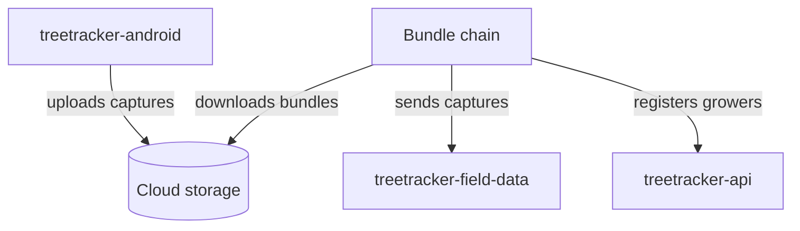
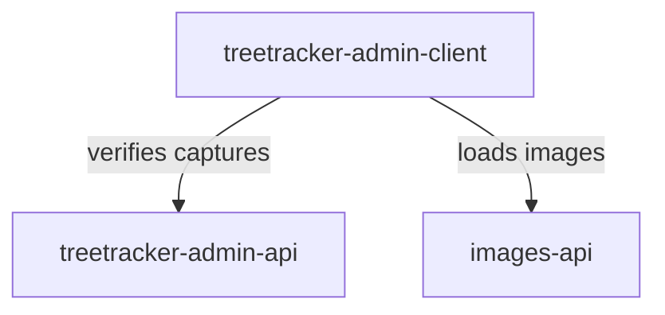
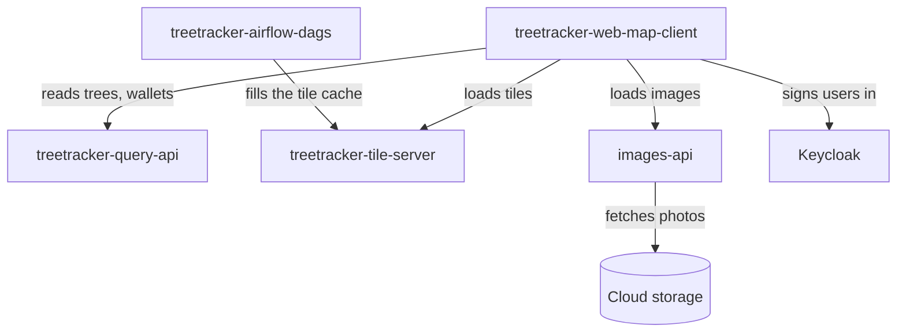
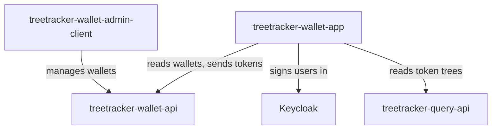
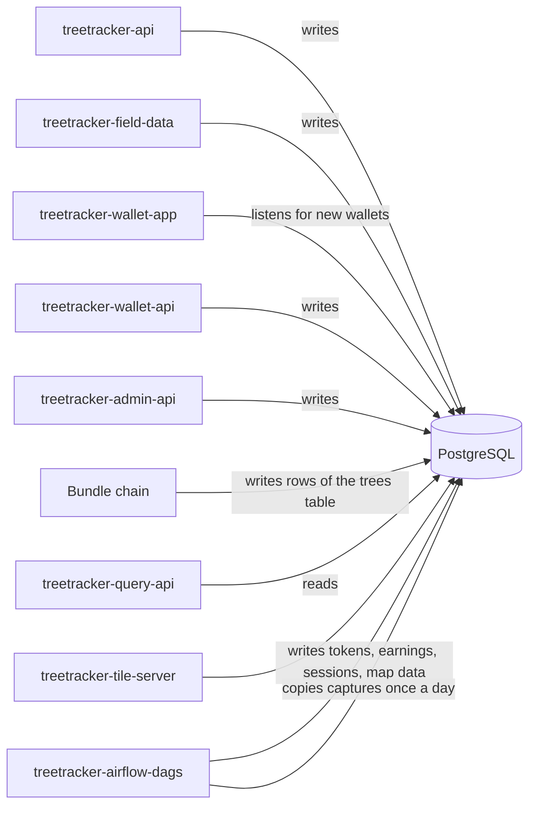
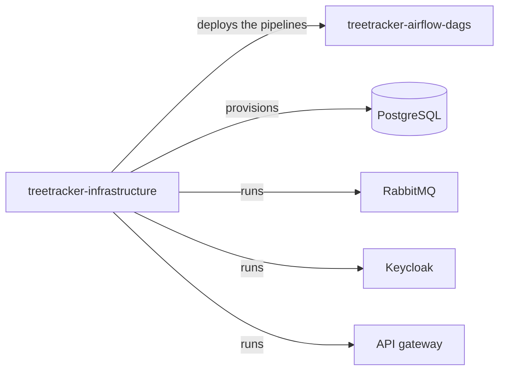

# How the Greenstand repos work together

These maps show how the 14 code repos of the estate work together at run time. A code repo is a
source repo that holds code. The maps show the main calls and the shared systems. They do not
show every call. The last map shows the platform that the code repos run on. To learn about
Greenstand itself, start with
[Greenstand-Overview](https://github.com/Greenstand/Greenstand-Overview) and
[How to contribute to Greenstand](./docs/contribute-to-greenstand.md).

How to read the maps:

- An arrow points from the repo or the system that uses something to the repo or the system
  that it uses.
- A cylinder is a store of data.

## Capture and verification

A grower uses the Treetracker app (treetracker-android). The app uploads the photos to object
storage. Then it uploads a bundle, a small data file that lists the captures. The bundle chain
opens each bundle. The bundle chain is four public repos outside the estate. It sends each
capture to treetracker-field-data, and it registers new growers with treetracker-api. One repo
of the chain also writes the row of a capture to the `trees` table of the old `public` schema,
if that row is not there yet. treetracker-field-data uses no message broker.

<!-- BEGIN ecosystem map capture: generated by .github/scripts/build-ecosystem-maps.mjs from estate.json and ecosystem.json. Do not edit by hand. -->

<!-- END ecosystem map capture -->

The admin panel (treetracker-admin-client) gets the captures to verify from
treetracker-admin-api, and it sends the verifications there. It loads the photos from
images-api. treetracker-admin-api stores each decision in the `trees` table. A job of
treetracker-airflow-dags is set to copy the decisions into the `field_data` and `treetracker`
schemas once a day (see [Shared database](#shared-database)).

<!-- BEGIN ecosystem map verification: generated by .github/scripts/build-ecosystem-maps.mjs from estate.json and ecosystem.json. Do not edit by hand. -->

<!-- END ecosystem map verification -->

A job of treetracker-airflow-dags is set to compute the earnings of the growers of one
organization from their approved captures every day. The admin panel lists the earnings and
logs the payments through an earnings API outside the estate.

For the story of one capture, from the grower's phone to the grower's reward, with pictures, see
[The journey of a capture](./docs/capture-journey.md).

For the data that an organization gets from its captures, with pictures, see
[chapter 4 of the capture journey](./docs/capture-journey-organizations.md).

## Web map

The web map (treetracker-web-map-client) reads trees, wallets, and tokens from
treetracker-query-api. It loads map tiles from treetracker-tile-server. It signs users in with
Keycloak. It loads the small photos of its lists from images-api. images-api fetches the photos
from cloud storage. The tree page loads the full photo from cloud storage.
treetracker-airflow-dags fills the tile cache before users ask for the tiles.

<!-- BEGIN ecosystem map web-map: generated by .github/scripts/build-ecosystem-maps.mjs from estate.json and ecosystem.json. Do not edit by hand. -->

<!-- END ecosystem map web-map -->

For the story of one capture on the public web map, with pictures, see
[chapter 2 of the capture journey](./docs/capture-journey-web-map.md).

## Wallet

The wallet app (treetracker-wallet-app) and the wallet admin panel
(treetracker-wallet-admin-client) use treetracker-wallet-api. The code has two versions of
treetracker-wallet-api that share one set of wallets. No public source confirms which version
each one uses in production. The wallet app signs users in with Keycloak. The wallet app reads
the tree of a token from treetracker-query-api for its token page.

No API creates tokens. A job of treetracker-airflow-dags creates them when an operator starts
it. The operator names an organization and a wallet. The job puts one token for each approved
capture of the growers of that organization and of its child organizations into that wallet. A
capture that has a token already gets no second token.

<!-- BEGIN ecosystem map wallet: generated by .github/scripts/build-ecosystem-maps.mjs from estate.json and ecosystem.json. Do not edit by hand. -->

<!-- END ecosystem map wallet -->

For the story of one capture as an impact token, with pictures, see
[chapter 3 of the capture journey](./docs/capture-journey-token.md).

## Shared database

The code repos share one PostgreSQL database. Most of them write to their own schema. Some also
write to shared schemas: treetracker-admin-api, treetracker-field-data, and the bundle chain
write to the old `public` schema. treetracker-airflow-dags writes tokens, earnings, session
segments, map data, stakeholder records, and the authors of messages. It is also set to run
domain-migration-scripts, a public repo outside the estate, once a day. This job copies the
captures and the decisions of the admins from the old `public` schema into the `field_data` and
`treetracker` schemas. treetracker-query-api and treetracker-tile-server read the data that the
other repos write. Thus, a schema change in one repo can affect them.
The user API of treetracker-wallet-app listens on a PostgreSQL channel for new wallets.

<!-- BEGIN ecosystem map database: generated by .github/scripts/build-ecosystem-maps.mjs from estate.json and ecosystem.json. Do not edit by hand. -->

<!-- END ecosystem map database -->

## Platform

This map shows what treetracker-infrastructure provides. It does not show run-time calls.
treetracker-infrastructure provisions the database. It runs RabbitMQ, Keycloak, and the API
gateway. It also deploys the pipelines (Airflow DAGs) of treetracker-airflow-dags.

The workflows of the other code repos start their deploys. Each code repo uses one of these
ways:

- A workflow applies the Kubernetes manifests of the code repo to a cluster.
- A workflow commits the new image tag to the Kubernetes manifests. Then a GitOps controller
  outside the estate applies the change. A GitOps controller is a program that applies the
  changes in a repo to a cluster.
- A workflow uploads the files of a web app to static hosting.
- A workflow sends the Android app to the Google Play Store.

For the container registry, the clusters, and the other resources that the code repos share,
see the [shared-resource page](./docs/shared-resources.md).

<!-- BEGIN ecosystem map platform: generated by .github/scripts/build-ecosystem-maps.mjs from estate.json and ecosystem.json. Do not edit by hand. -->

<!-- END ecosystem map platform -->

## Not on the maps

- Most links to systems outside the estate. Examples:
  - The earnings API (see [Capture and verification](#capture-and-verification)).
  - The stakeholder API. The earnings API gets the names of the growers from it.
  - The tables of the contract API. The earnings job reads the dates of its payment rule from
    them. The rule itself is in the code of the job.
  - A map data API and a messaging API.
- treetracker-api and treetracker-field-data have routes that update rows of the `trees` table
  through treetracker-admin-api. No client calls these routes today: the admin panel calls
  treetracker-admin-api directly.
- Queues that only one repo of the estate uses, and a message that only a development setup
  sends.
- In production, the web map loads tiles from tile hosts. No repo of the estate shows what
  serves these hosts.
- Small reads, for example of country names, and the static hosting of the web apps.

## How the maps are made

The edges come from [`ecosystem.json`](./ecosystem.json). Each edge records its evidence: a file
and a line in the source repo, at its snapshot commit. An edge of a system outside the estate
cites a public repo outside the estate, with its commit (`@<commit>`).
`.github/scripts/build-ecosystem-maps.mjs` draws the maps from `ecosystem.json` and
`estate.json`. The `Estate index` check fails a pull request if a map is stale, or if
`ecosystem.json` has an error. It also fails after a repo is regenerated: a person checks the
edges of that repo again, then sets its `checkedAt` entry to the new snapshot commit.
