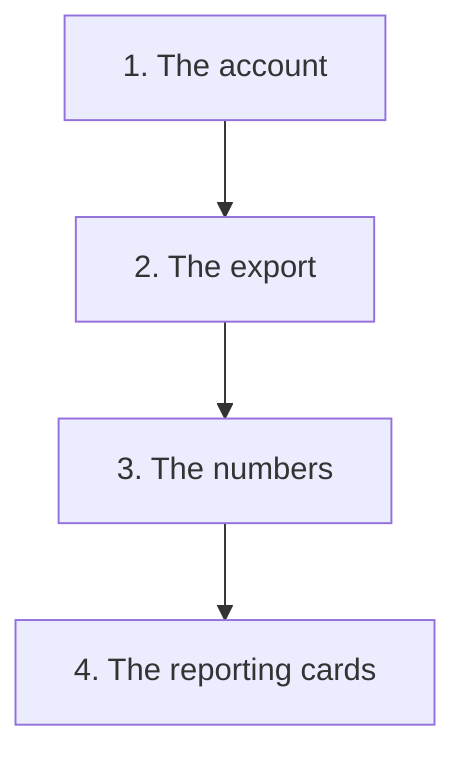

<!-- Built by .github/scripts/build-capture-journey.mjs from capture-journey.json. Do not edit. -->

# The journey of a capture

**Chapter 4: The capture in the data for organizations**

This is the text copy of the page for GitHub. The illustrated page is on the [Pages site](https://greenstand.github.io/greenstand-documentation/capture-journey-organizations.html).

This chapter starts at [stage 4 of chapter 1: The record](capture-journey.md#4-the-record-the-capture-waits-for-verification). Chapters 2 to 4 follow the same capture on different paths. Their numbers give only the reading order.

This chapter follows one capture into the data that an organization gets. A grower works with an organization, for example a group that plants trees. The captures of the grower belong to that organization.

Greenstand sends no report to an organization. A person of the organization signs in to the admin panel to see the data. One organization gets cards with more numbers.

How to read this page:

- **Best guess:** No public source confirms this. A Greenstand maintainer will review it.
- **For developers:** The repo, the file, and the lines at the commit that this page describes.

## 1. The account: a person of the organization signs in

 A drawing of an organization account

A Greenstand maintainer gives a person of the organization an account in the admin panel. The role of the account names the organization.

When the person signs in, the admin panel asks only for the data of that organization. So the person sees the captures and the growers of that organization.

> **Best guess:** Some organizations have such accounts today, and their people use the Captures page and the export.

For developers

- treetracker-admin-api ([viewer](https://greenstand.github.io/greenstand-documentation/treetracker-admin-api/), [onboarding guide](https://greenstand.github.io/greenstand-documentation/treetracker-admin-api/onboarding.html))
  - [`auth.js` lines 141 to 143](https://github.com/Greenstand/treetracker-admin-api/blob/351db46/src/js/auth.js#L141-L143): the role of an account can name an organization
- treetracker-admin-client ([viewer](https://greenstand.github.io/greenstand-documentation/treetracker-admin-client/), [onboarding guide](https://greenstand.github.io/greenstand-documentation/treetracker-admin-client/onboarding.html))
  - [`apiUtils.js` lines 30 to 33](https://github.com/Greenstand/treetracker-admin-client/blob/c2076e4/src/api/apiUtils.js#L30-L33): the admin panel asks for the data of the organization of the account
  - [`CapturesContext.js` lines 58 to 61](https://github.com/Greenstand/treetracker-admin-client/blob/c2076e4/src/context/CapturesContext.js#L58-L61): the admin panel asks for the captures of the organization of the account
  - [`growers.js` lines 45 to 47](https://github.com/Greenstand/treetracker-admin-client/blob/c2076e4/src/api/growers.js#L45-L47): the admin panel asks for the growers of the organization of the account

## 2. The export: the person downloads a spreadsheet

 A drawing of the export

On the Captures page, the person sees the captures of the organization. By default, the list shows the captures that no admin approved yet and the captures that an admin approved. A filter can make the list smaller.

The button “Export Captures” opens a dialog. The person picks the columns, and the admin panel downloads a spreadsheet file with one row for each capture. The file holds up to 20,000 captures.

Greenstand’s product page says that the web map and the admin panel show the trees on a map. An organization can then confirm the place and the health of each tree. The admin panel of today shows the data in a list, in numbers, and in a file. The public web map shows the trees on a map. See [chapter 2: The capture on the public web map](capture-journey-web-map.md).

For developers

- treetracker-admin-client ([viewer](https://greenstand.github.io/greenstand-documentation/treetracker-admin-client/), [onboarding guide](https://greenstand.github.io/greenstand-documentation/treetracker-admin-client/onboarding.html))
  - [`CaptureTable.js` lines 260 to 270](https://github.com/Greenstand/treetracker-admin-client/blob/c2076e4/src/components/Captures/CaptureTable.js#L260-L270): the Captures page has the Export Captures button and dialog
  - [`CapturesContext.js` lines 38 to 45](https://github.com/Greenstand/treetracker-admin-client/blob/c2076e4/src/context/CapturesContext.js#L38-L45): the list shows the captures that wait and the captures that are approved
  - [`CapturesContext.js` lines 99 to 110](https://github.com/Greenstand/treetracker-admin-client/blob/c2076e4/src/context/CapturesContext.js#L99-L110): the export takes up to 20,000 captures
- [greenstand-documentation](https://github.com/Greenstand/greenstand-documentation) (no guide in these docs)
  - [`products.md` line 12](https://github.com/Greenstand/greenstand-documentation/blob/6f415de/general/overview/introduction/products.md?plain=1#L12): Greenstand’s product page: the admin panel shows the trees on a map

## 3. The Home page: four numbers

 A drawing of the four numbers

The Home page of the admin panel shows four numbers for the organization. They are “Total Captures”, “Untagged Captures” (the captures that no admin approved yet), “Verified Captures”, and “Growers”.

The numbers count the captures and the growers that the admin panel asks for (stage 1). When an admin approves a capture, the capture moves from “Untagged Captures” to “Verified Captures”.

Greenstand does not send these numbers to the organization: no report, no email, and no message. A person must sign in to see them. The impact tokens of the organization are in its wallet. See [chapter 3: The capture as an impact token](capture-journey-token.md).

For developers

- treetracker-admin-client ([viewer](https://greenstand.github.io/greenstand-documentation/treetracker-admin-client/), [onboarding guide](https://greenstand.github.io/greenstand-documentation/treetracker-admin-client/onboarding.html))
  - [`DashStat.container.js` lines 37 to 66](https://github.com/Greenstand/treetracker-admin-client/blob/c2076e4/src/components/DashStat.container.js#L37-L66): the numbers of all captures and of the captures that wait
  - [`DashStat.container.js` lines 95 to 122](https://github.com/Greenstand/treetracker-admin-client/blob/c2076e4/src/components/DashStat.container.js#L95-L122): the numbers of the verified captures and of the growers
  - [`treeTrackerApi.js` lines 122 to 124](https://github.com/Greenstand/treetracker-admin-client/blob/c2076e4/src/api/treeTrackerApi.js#L122-L124): the admin panel asks for the counts of the organization of the account

## 4. The reporting cards: one organization sees more

 A drawing of the reporting cards

One organization, Freetown City Council, sees reporting cards on its Home page. A job copies the captures of the council’s growers into separate tables of the database. A reporting service counts the captures of these tables for the cards.

The cards show counts and short lists, for example the top growers, the catchment areas, and the trees that survive.

> **Best guess:** The copy job and the reporting service run in production today, and the council still uses the cards.

For developers

- treetracker-airflow-dags ([viewer](https://greenstand.github.io/greenstand-documentation/treetracker-airflow-dags/), [onboarding guide](https://greenstand.github.io/greenstand-documentation/treetracker-airflow-dags/onboarding.html))
  - [`populate-reports-schema.py` line 98](https://github.com/Greenstand/treetracker-airflow-dags/blob/6ede7fe/populate-reports-schema.py#L98): the job takes only the growers of one organization and its member groups
  - [`populate-reports-schema.py` line 105](https://github.com/Greenstand/treetracker-airflow-dags/blob/6ede7fe/populate-reports-schema.py#L105): the job writes the copies to separate tables
- treetracker-admin-client ([viewer](https://greenstand.github.io/greenstand-documentation/treetracker-admin-client/), [onboarding guide](https://greenstand.github.io/greenstand-documentation/treetracker-admin-client/onboarding.html))
  - [`Home.js` lines 208 to 221](https://github.com/Greenstand/treetracker-admin-client/blob/c2076e4/src/components/Home/Home.js#L208-L221): the reporting cards on the Home page
  - [`ReportingCard4.js` lines 20 to 22](https://github.com/Greenstand/treetracker-admin-client/blob/c2076e4/src/components/reportingCards/ReportingCard4.js#L20-L22): the card of the top growers
  - [`ReportingCard7.js` lines 20 to 22](https://github.com/Greenstand/treetracker-admin-client/blob/c2076e4/src/components/reportingCards/ReportingCard7.js#L20-L22): the card of the catchment areas
  - [`ReportingCard10.js` lines 20 to 22](https://github.com/Greenstand/treetracker-admin-client/blob/c2076e4/src/components/reportingCards/ReportingCard10.js#L20-L22): the card of the trees that survive
  - [issue #654](https://github.com/Greenstand/treetracker-admin-client/issues/654): asks for the reporting cards for all organizations
- [greenstand-documentation](https://github.com/Greenstand/greenstand-documentation) (no guide in these docs)
  - [`overview-and-requirements.md` line 9](https://github.com/Greenstand/greenstand-documentation/blob/6f415de/admin-panel/development/admin-panel/freetown-phase-2-admin-panel/overview-and-requirements.md?plain=1#L9): a Greenstand design page names Freetown City Council
- [treetracker-reporting](https://github.com/Greenstand/treetracker-reporting) (no guide in these docs)
  - [`kustomization.yaml` lines 6 to 7](https://github.com/Greenstand/treetracker-reporting/blob/6b5f2e8/deployment/overlays/production/kustomization.yaml#L6-L7): the production setup of the reporting service

## Chapters

- [Chapter 1: From the grower’s phone to the grower’s reward](capture-journey.md)
- [Chapter 2: The capture on the public web map](capture-journey-web-map.md)
- [Chapter 3: The capture as an impact token](capture-journey-token.md)
- Chapter 4: The capture in the data for organizations (this page)
