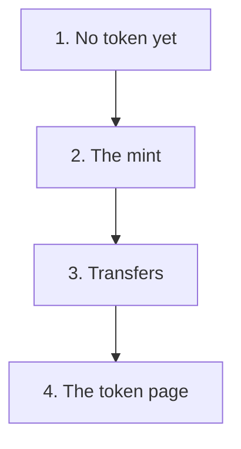

<!-- Built by .github/scripts/build-capture-journey.mjs from capture-journey.json. Do not edit. -->

# The journey of a capture

**Chapter 3: The capture as an impact token**

This is the text copy of the page for GitHub. The illustrated page is on the [Pages site](https://greenstand.github.io/greenstand-documentation/capture-journey-token.html).

This chapter starts at [stage 5 of chapter 1: Verification](capture-journey.md#5-verification-an-admin-checks-the-photo). Chapters 2 to 4 follow the same capture on different paths. Their numbers give only the reading order.

This chapter follows one capture to an impact token. An impact token is a record in a wallet. It points to one capture. It is not money: it has no price, and it does not pay the grower.

Greenstand’s white paper and its model pages describe a goal for tokens. This chapter shows the code of today. A note at a stage says where the goal and the code differ.

How to read this page:

- **Best guess:** No public source confirms this. A Greenstand maintainer will review it.
- **For developers:** The repo, the file, and the lines at the commit that this page describes.

## 1. The approval: no token yet

 A drawing of an approved capture with no token

An admin approves the capture (chapter 1, stage 5). The older tree record has a field for a token, but the field stays empty. Nothing makes a token at this step. An open issue in Greenstand’s wallet code asks for a token at the approval.

So the screens say that no token exists. In the admin panel, the capture detail says "Impact token not issued", and a filter of the Captures page shows "Not Tokenized". On the web map, the tree page shows the badge "Token not issued".

For developers

- treetracker-admin-api ([viewer](https://greenstand.github.io/greenstand-documentation/treetracker-admin-api/), [onboarding guide](https://greenstand.github.io/greenstand-documentation/treetracker-admin-api/onboarding.html))
  - [`trees.model.ts` lines 380 to 384](https://github.com/Greenstand/treetracker-admin-api/blob/351db46/src/models/trees.model.ts#L380-L384): the older tree record has a token field
- treetracker-admin-client ([viewer](https://greenstand.github.io/greenstand-documentation/treetracker-admin-client/), [onboarding guide](https://greenstand.github.io/greenstand-documentation/treetracker-admin-client/onboarding.html))
  - [`CaptureDetailDialog.js` lines 386 to 394](https://github.com/Greenstand/treetracker-admin-client/blob/c2076e4/src/components/CaptureDetailDialog.js#L386-L394): the capture detail says that no token exists
  - [`variables.js` lines 9 to 12](https://github.com/Greenstand/treetracker-admin-client/blob/c2076e4/src/common/variables.js#L9-L12): the token filter of the Captures page
- treetracker-web-map-client ([viewer](https://greenstand.github.io/greenstand-documentation/treetracker-web-map-client/), [onboarding guide](https://greenstand.github.io/greenstand-documentation/treetracker-web-map-client/onboarding.html))
  - [`[treeid].js` lines 196 to 199](https://github.com/Greenstand/treetracker-web-map-client/blob/1529888/src/pages/trees/%5Btreeid%5D.js#L196-L199): the token badge of the tree page
- treetracker-wallet-api ([viewer](https://greenstand.github.io/greenstand-documentation/treetracker-wallet-api/), [onboarding guide](https://greenstand.github.io/greenstand-documentation/treetracker-wallet-api/onboarding.html))
  - [issue #556](https://github.com/Greenstand/treetracker-wallet-api/issues/556): asks for a token at the approval

## 2. The mint: an operator makes the tokens

 A drawing of the mint

Later, a Greenstand operator starts a job by hand. No timer starts it. The operator names an organization and a wallet. The job finds each approved capture of the growers of that organization that has no token yet.

For each of these captures, the job makes one impact token in the named wallet. A token is a small record: it points to one capture and to one wallet. A capture can have only one token. The operator picks the wallet, not the grower.

> **Best guess:** An operator still starts this job today. The wallet is usually the wallet of the organization.

Greenstand’s white paper describes a goal. In that goal, a capture holds its first wallet, and the grower comes first. The system makes a token only when no other claim conflicts. Today, the field data service stores a target wallet with each session of the app, but the token job does not read it.

For developers

- treetracker-airflow-dags ([viewer](https://greenstand.github.io/greenstand-documentation/treetracker-airflow-dags/), [onboarding guide](https://greenstand.github.io/greenstand-documentation/treetracker-airflow-dags/onboarding.html))
  - [`create-tokens.py` lines 40 to 48](https://github.com/Greenstand/treetracker-airflow-dags/blob/6ede7fe/create-tokens.py#L40-L48): the job runs only when an operator starts it
- treetracker-wallet-api ([viewer](https://greenstand.github.io/greenstand-documentation/treetracker-wallet-api/), [onboarding guide](https://greenstand.github.io/greenstand-documentation/treetracker-wallet-api/onboarding.html))
  - [`20200901213253-CreateTableToken.js` lines 18 to 21](https://github.com/Greenstand/treetracker-wallet-api/blob/e95c15a/database/migrations/20200901213253-CreateTableToken.js#L18-L21): a token points to one capture and one wallet
  - [`20210304014730-AddUniqueConstraintCaptureId.js` line 18](https://github.com/Greenstand/treetracker-wallet-api/blob/e95c15a/database/migrations/20210304014730-AddUniqueConstraintCaptureId.js#L18): a capture has one token at most
- treetracker-field-data ([viewer](https://greenstand.github.io/greenstand-documentation/treetracker-field-data/), [onboarding guide](https://greenstand.github.io/greenstand-documentation/treetracker-field-data/onboarding.html))
  - [`SessionModel.js` lines 13 to 14](https://github.com/Greenstand/treetracker-field-data/blob/8ffb53c/server/models/SessionModel.js#L13-L14): each session of the app has a target wallet
- [greenstand-documentation](https://github.com/Greenstand/greenstand-documentation) (no guide in these docs)
  - [`white-paper.md` line 204](https://github.com/Greenstand/greenstand-documentation/blob/6f415de/docs/introduction/the-model/white-paper.md?plain=1#L204): the white paper: when a token is made
  - [`white-paper.md` lines 208 to 210](https://github.com/Greenstand/greenstand-documentation/blob/6f415de/docs/introduction/the-model/white-paper.md?plain=1#L208-L210): the white paper: the first wallet comes from the capture
  - [`white-paper.md` line 214](https://github.com/Greenstand/greenstand-documentation/blob/6f415de/docs/introduction/the-model/white-paper.md?plain=1#L214): the white paper: the grower comes first

## 3. Transfers: the holder sends tokens to other wallets

 A drawing of the transfers

The holder of a wallet can send tokens to another wallet, for example the wallet of a funder. If the holder controls both wallets, or the two wallets trust each other, the tokens move at once. Otherwise, the other side must accept the transfer first. The wallet service records each move of a token.

An organization uses the wallet admin panel to send a number of tokens. A person can use the newer wallet app. It shows the tokens, accepts transfers, and makes share links with a QR code. Anyone who opens a share link can claim its tokens into a new wallet. A transfer can also mark tokens as "claimed". A claimed token cannot move again.

> **Best guess:** The wallet admin panel and the wallet app both work in production today. They use two versions of the wallet service that share one set of wallets.

The white paper describes five token states and trade on a blockchain. The code has no blockchain. It marks a token only as "in a transfer" or "claimed". A claimed token is the nearest to a retired token of the white paper.

For developers

- treetracker-wallet-api ([viewer](https://greenstand.github.io/greenstand-documentation/treetracker-wallet-api/), [onboarding guide](https://greenstand.github.io/greenstand-documentation/treetracker-wallet-api/onboarding.html))
  - [`Transfer.js` lines 200 to 214](https://github.com/Greenstand/treetracker-wallet-api/blob/e95c15a/server/models/Transfer.js#L200-L214): both wallets, or a trust: the transfer is complete at once
  - [`Transfer.js` lines 222 to 237](https://github.com/Greenstand/treetracker-wallet-api/blob/e95c15a/server/models/Transfer.js#L222-L237): otherwise the transfer waits
  - [`Transfer.js` lines 367 to 384](https://github.com/Greenstand/treetracker-wallet-api/blob/e95c15a/server/models/Transfer.js#L367-L384): the receiver accepts
  - [`Token.js` lines 55 to 75](https://github.com/Greenstand/treetracker-wallet-api/blob/e95c15a/server/models/Token.js#L55-L75): each token moves, and each move is recorded
  - [`Transfer.js` lines 174 to 178](https://github.com/Greenstand/treetracker-wallet-api/blob/e95c15a/server/models/Transfer.js#L174-L178): a claimed token cannot move
- treetracker-wallet-admin-client ([viewer](https://greenstand.github.io/greenstand-documentation/treetracker-wallet-admin-client/), [onboarding guide](https://greenstand.github.io/greenstand-documentation/treetracker-wallet-admin-client/onboarding.html))
  - [`SendTokens.js` lines 174 to 181](https://github.com/Greenstand/treetracker-wallet-admin-client/blob/81b71cb/src/pages/SendTokens/SendTokens.js#L174-L181): the wallet admin panel sends a number of tokens
- treetracker-wallet-app ([viewer](https://greenstand.github.io/greenstand-documentation/treetracker-wallet-app/), [onboarding guide](https://greenstand.github.io/greenstand-documentation/treetracker-wallet-app/onboarding.html))
  - [`page.tsx` lines 68 to 80](https://github.com/Greenstand/treetracker-wallet-app/blob/a7ea1cd/apps/web/src/app/%28protected%29/transfers/page.tsx#L68-L80): the wallet app accepts a transfer
  - [`page.tsx` lines 138 to 152](https://github.com/Greenstand/treetracker-wallet-app/blob/a7ea1cd/apps/web/src/app/%28protected%29/send/page.tsx#L138-L152): the wallet app makes a share link with a QR code
- [greenstand-documentation](https://github.com/Greenstand/greenstand-documentation) (no guide in these docs)
  - [`white-paper.md` line 157](https://github.com/Greenstand/greenstand-documentation/blob/6f415de/docs/introduction/the-model/white-paper.md?plain=1#L157): the white paper: five token states
  - [`white-paper.md` line 251](https://github.com/Greenstand/greenstand-documentation/blob/6f415de/docs/introduction/the-model/white-paper.md?plain=1#L251): the white paper: trade on a blockchain

## 4. The token page: anyone can see the token

 A drawing of the token page

On the web map, the badge of the tree page now says "Token issued". The token page shows the token number, the date, the tree, and the wallet that holds the token. It also shows the claim status, and if the token can move. A timeline shows each transfer between wallets. The wallet app links to the same page.

A wallet page shows the name of the wallet and how many tokens it holds. No page shows a price. A token holds no money and no payment data.

Greenstand’s product page says that investors and consumers can buy, sell, and trade impact tokens, and that this pays the grower. The white paper gives each token a value. The business model on Greenstand’s model page names an impact token fee of 3% of the uploaded captures. The code of today has none of these. A token has no price and no value, and it moves only by transfer. The token job takes no fee, and a token does not pay the grower. See [Greenstand’s model page](https://docs.greenstand.org/overview/introduction/the-model).

For developers

- treetracker-wallet-app ([viewer](https://greenstand.github.io/greenstand-documentation/treetracker-wallet-app/), [onboarding guide](https://greenstand.github.io/greenstand-documentation/treetracker-wallet-app/onboarding.html))
  - [`page.tsx` lines 61 to 64](https://github.com/Greenstand/treetracker-wallet-app/blob/a7ea1cd/apps/web/src/app/%28protected%29/token/details/page.tsx#L61-L64): the wallet app links the token page of the web map
- treetracker-web-map-client ([viewer](https://greenstand.github.io/greenstand-documentation/treetracker-web-map-client/), [onboarding guide](https://greenstand.github.io/greenstand-documentation/treetracker-web-map-client/onboarding.html))
  - [`[tokenid].js` lines 450 to 466](https://github.com/Greenstand/treetracker-web-map-client/blob/1529888/src/pages/tokens/%5Btokenid%5D.js#L450-L466): the date and the token number
  - [`[tokenid].js` lines 486 to 503](https://github.com/Greenstand/treetracker-web-map-client/blob/1529888/src/pages/tokens/%5Btokenid%5D.js#L486-L503): the claim status, and if the token can move
  - [`[tokenid].js` lines 578 to 586](https://github.com/Greenstand/treetracker-web-map-client/blob/1529888/src/pages/tokens/%5Btokenid%5D.js#L578-L586): the timeline of the transfers
  - [`[walletid].js` lines 312 to 313](https://github.com/Greenstand/treetracker-web-map-client/blob/1529888/src/pages/wallets/%5Bwalletid%5D.js#L312-L313): the wallet page counts the tokens
- [greenstand-documentation](https://github.com/Greenstand/greenstand-documentation) (no guide in these docs)
  - [`products.md` line 20](https://github.com/Greenstand/greenstand-documentation/blob/6f415de/docs/introduction/products.md?plain=1#L20): the product page: buy, sell, and pay the grower
  - [`white-paper.md` line 122](https://github.com/Greenstand/greenstand-documentation/blob/6f415de/docs/introduction/the-model/white-paper.md?plain=1#L122): the white paper: a token has a value
  - [`README.md` line 15](https://github.com/Greenstand/greenstand-documentation/blob/6f415de/docs/introduction/the-model/README.md?plain=1#L15): the model page links the business model, which names the token fee
- treetracker-query-api ([viewer](https://greenstand.github.io/greenstand-documentation/treetracker-query-api/), [onboarding guide](https://greenstand.github.io/greenstand-documentation/treetracker-query-api/onboarding.html)): gives the data of the token page and the wallet page

## Chapters

- [Chapter 1: From the grower’s phone to the grower’s reward](capture-journey.md)
- [Chapter 2: The capture on the public web map](capture-journey-web-map.md)
- Chapter 3: The capture as an impact token (this page)
- [Chapter 4: The capture in the data for organizations](capture-journey-organizations.md)
