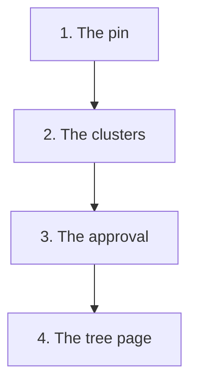
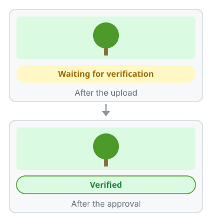

<!-- Built by .github/scripts/build-capture-journey.mjs from capture-journey.json. Do not edit. -->

# The journey of a capture

**Chapter 2: The capture on the public web map**

This is the text copy of the page for GitHub. The illustrated page is on the [Pages site](https://greenstand.github.io/greenstand-documentation/capture-journey-web-map.html).

This chapter starts at [stage 4 of chapter 1: The record](capture-journey.md#4-the-record-the-capture-waits-for-verification). Chapters 2 to 4 follow the same capture on different paths. Their numbers give only the reading order.

This chapter follows one capture onto the public web map, map.treetracker.org. Anyone can open the map and see the trees that growers captured.

The web map shows a capture in two ways. Close up, it is a pin. From further away, it is a part of the number on a cluster. A click on a pin opens the tree page.

How to read this page:

- **Best guess:** No public source confirms this. A Greenstand maintainer will review it.
- **For developers:** The repo, the file, and the lines at the commit that this page describes.

## 1. The pin: the capture is on the map before verification

 A drawing of the map close up

When the field data service stores the capture (chapter 1, stage 4), the database also keeps an older tree record of it. This record is "active" at once. It is not "approved" yet.

The map is a set of small square images, the tiles. The browser asks the tile server for each tile. The mark "active" shows a capture on the map. So close up, the new capture is a pin at once, before an admin verifies it.

Greenstand’s product page says that the web map shows verified trees. Today, the map shows each active capture, also before verification.

For developers

- treetracker-field-data ([viewer](https://greenstand.github.io/greenstand-documentation/treetracker-field-data/), [onboarding guide](https://greenstand.github.io/greenstand-documentation/treetracker-field-data/onboarding.html))
  - [`legacy-table-creation.js` lines 5 to 25](https://github.com/Greenstand/treetracker-field-data/blob/8ffb53c/__tests__/legacy-table-creation.js#L5-L25): the older trees table gives a new record "active" by default (the test copy of the table)
- [treetracker-database](https://github.com/Greenstand/treetracker-database) (no guide in these docs)
  - [`20190511003640-AddApprovedToTrees.js` lines 18 to 22](https://github.com/Greenstand/treetracker-database/blob/589e8e2/main/migrations/20190511003640-AddApprovedToTrees.js#L18-L22): a new tree record is not approved
- [treetracker-web-map-core](https://github.com/Greenstand/treetracker-web-map-core) (no guide in these docs)
  - [`Map.js` lines 259 to 262](https://github.com/Greenstand/treetracker-web-map-core/blob/506a5db/src/Map.js#L259-L262): the map asks for the tiles
- [greenstand-documentation](https://github.com/Greenstand/greenstand-documentation) (no guide in these docs)
  - [`products.md` line 18](https://github.com/Greenstand/greenstand-documentation/blob/6f415de/docs/introduction/products.md?plain=1#L18): the product page says "verified trees"
- treetracker-tile-server ([viewer](https://greenstand.github.io/greenstand-documentation/treetracker-tile-server/), [onboarding guide](https://greenstand.github.io/greenstand-documentation/treetracker-tile-server/onboarding.html)): draws the tiles of the map from the database

## 2. The clusters: a job adds the capture to the counts

 A drawing of the map further away

From further away, the map groups the captures into round clusters. A cluster shows a number: the count of its captures.

An automatic job is set to run every 2 hours. It finds the active captures that are not in a cluster yet. Then it builds the clusters again. Until the next run, the new capture is a pin close up. It is not in the counts yet.

> **Best guess:** The job runs every 2 hours in production today.

For developers

- treetracker-airflow-dags ([viewer](https://greenstand.github.io/greenstand-documentation/treetracker-airflow-dags/), [onboarding guide](https://greenstand.github.io/greenstand-documentation/treetracker-airflow-dags/onboarding.html))
  - [`assign-new-trees-to-clusters.py` lines 40 to 50](https://github.com/Greenstand/treetracker-airflow-dags/blob/6ede7fe/map/assign-new-trees-to-clusters.py#L40-L50): the job is set to run every 2 hours
  - [`assign_new_trees_to_cluster.py` lines 14 to 26](https://github.com/Greenstand/treetracker-airflow-dags/blob/6ede7fe/lib/assign_new_trees_to_cluster.py#L14-L26): it finds the new active captures
  - [`assign_new_trees_to_cluster.py` lines 103 to 134](https://github.com/Greenstand/treetracker-airflow-dags/blob/6ede7fe/lib/assign_new_trees_to_cluster.py#L103-L134): it builds the clusters again
- [treetracker-database](https://github.com/Greenstand/treetracker-database) (no guide in these docs)
  - [`20190712210225-AddClusterRegionsAssignedToTrees.js` lines 18 to 22](https://github.com/Greenstand/treetracker-database/blob/589e8e2/main/migrations/20190712210225-AddClusterRegionsAssignedToTrees.js#L18-L22): a new capture is not in a cluster yet
- treetracker-tile-server ([viewer](https://greenstand.github.io/greenstand-documentation/treetracker-tile-server/), [onboarding guide](https://greenstand.github.io/greenstand-documentation/treetracker-tile-server/onboarding.html)): draws the clusters and their counts

## 3. The approval: only the tree page changes

 Only the badge of the tree page changes

An admin approves the capture (chapter 1, stage 5). The admin panel saves "approved" in the record. It also saves the age of the tree, the type of planting, and the species if the admin knows it. Nothing sends a message to the map. The pin and the counts stay the same.

Only the tree page changes. Its badge "Waiting for verification" becomes "Verified". If the admin rejects the capture, the record is not active any more. Then the map hides it.

For developers

- treetracker-admin-client ([viewer](https://greenstand.github.io/greenstand-documentation/treetracker-admin-client/), [onboarding guide](https://greenstand.github.io/greenstand-documentation/treetracker-admin-client/onboarding.html))
  - [`SidePanel.js` lines 191 to 227](https://github.com/Greenstand/treetracker-admin-client/blob/c2076e4/src/components/SidePanel.js#L191-L227): the admin sets the type of planting and the age
  - [`treeTrackerApi.js` lines 98 to 115](https://github.com/Greenstand/treetracker-admin-client/blob/c2076e4/src/api/treeTrackerApi.js#L98-L115): a rejection makes the record not active
- treetracker-admin-api ([viewer](https://greenstand.github.io/greenstand-documentation/treetracker-admin-api/), [onboarding guide](https://greenstand.github.io/greenstand-documentation/treetracker-admin-api/onboarding.html))
  - [`trees.controller.ts` line 200](https://github.com/Greenstand/treetracker-admin-api/blob/351db46/src/controllers/trees.controller.ts#L200): the service saves the decision
- treetracker-web-map-client ([viewer](https://greenstand.github.io/greenstand-documentation/treetracker-web-map-client/), [onboarding guide](https://greenstand.github.io/greenstand-documentation/treetracker-web-map-client/onboarding.html))
  - [`[treeid].js` lines 191 to 199](https://github.com/Greenstand/treetracker-web-map-client/blob/1529888/src/pages/trees/%5Btreeid%5D.js#L191-L199): the badges of the tree page

## 4. The tree page: what a visitor sees

 A drawing of the tree page

A visitor clicks a pin. The web map opens the tree page beside the map. The page shows the photo, the tree number, the badges, the date of the capture, the country, and the species. The photo comes straight from cloud storage.

The web map keeps each tree page for a time before it builds the page again. So "Verified" can show hours after the approval.

> **Best guess:** The web map keeps a tree page for some hours in production, on purpose.

The web map reads only the older tree records. The job of chapter 1 that copies the decision into the newer tables is not on this path.

For developers

- [treetracker-web-map-core](https://github.com/Greenstand/treetracker-web-map-core) (no guide in these docs)
  - [`Map.js` lines 314 to 318](https://github.com/Greenstand/treetracker-web-map-core/blob/506a5db/src/Map.js#L314-L318): a click on a pin
- treetracker-web-map-client ([viewer](https://greenstand.github.io/greenstand-documentation/treetracker-web-map-client/), [onboarding guide](https://greenstand.github.io/greenstand-documentation/treetracker-web-map-client/onboarding.html))
  - [`pathResolver.js` lines 80 to 82](https://github.com/Greenstand/treetracker-web-map-client/blob/1529888/src/models/pathResolver.js#L80-L82): the tree page opens
  - [`[treeid].js` lines 474 to 492](https://github.com/Greenstand/treetracker-web-map-client/blob/1529888/src/pages/trees/%5Btreeid%5D.js#L474-L492): the photo from its stored address, and the tree number
  - [`[treeid].js` lines 631 to 660](https://github.com/Greenstand/treetracker-web-map-client/blob/1529888/src/pages/trees/%5Btreeid%5D.js#L631-L660): the date, the country, and the species
- treetracker-query-api ([viewer](https://greenstand.github.io/greenstand-documentation/treetracker-query-api/), [onboarding guide](https://greenstand.github.io/greenstand-documentation/treetracker-query-api/onboarding.html)): gives the data of the tree page
- images-api ([viewer](https://greenstand.github.io/greenstand-documentation/images-api/), [onboarding guide](https://greenstand.github.io/greenstand-documentation/images-api/onboarding.html)): makes the small photos in the lists of the web map

## Chapters

- [Chapter 1: From the grower’s phone to the grower’s reward](capture-journey.md)
- Chapter 2: The capture on the public web map (this page)
- [Chapter 3: The capture as an impact token](capture-journey-token.md)
- [Chapter 4: The capture in the data for organizations](capture-journey-organizations.md)
