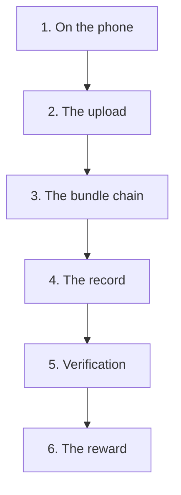
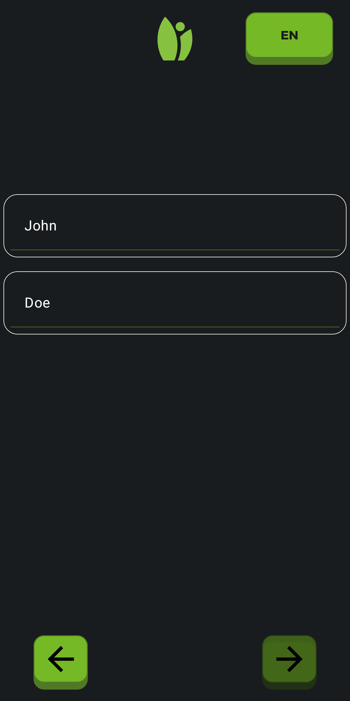
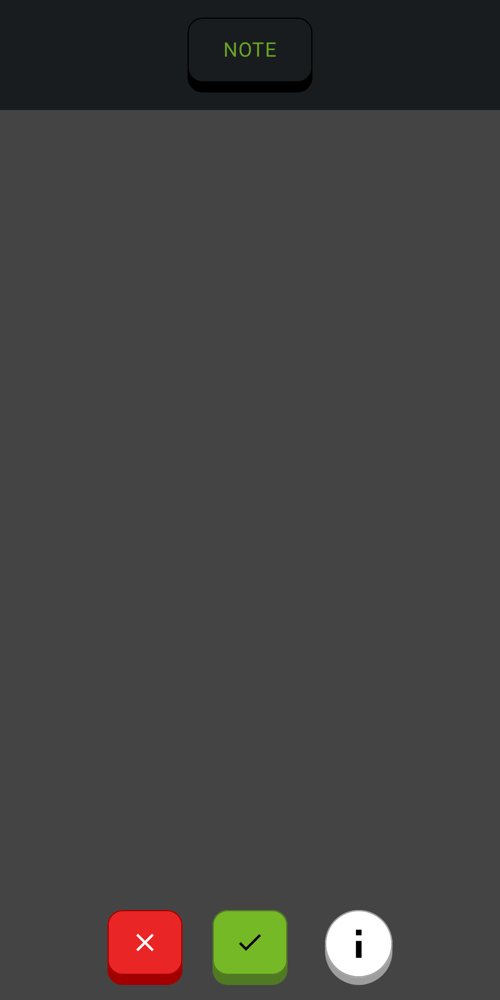
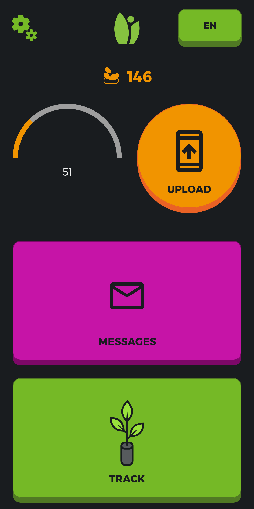
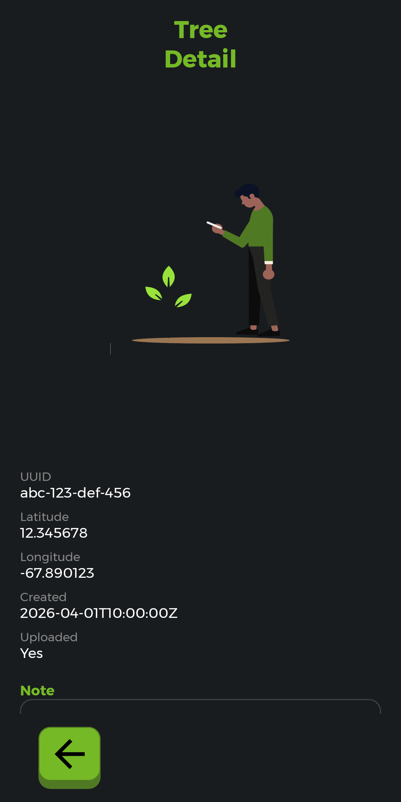
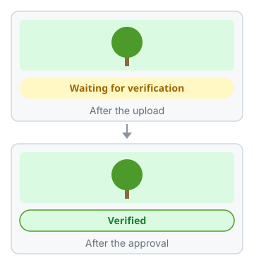
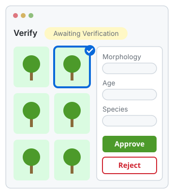

<!-- Built by .github/scripts/build-capture-journey.mjs from capture-journey.json. Do not edit. -->

# The journey of a capture

**Chapter 1: From the grower’s phone to the grower’s reward**

This is the text copy of the page for GitHub. The illustrated page is on the [Pages site](https://greenstand.github.io/greenstand-documentation/capture-journey.html).

This page follows one capture through the Greenstand system. A capture is one photo of a tree, with its GPS point and some data. A grower takes it with the Treetracker app.

Chapter 1 follows the capture from the grower’s phone to the grower’s reward. This page says "grower". Older code and tables say "planter" for the same person.

How to read this page:

- **Best guess:** No public source confirms this. A Greenstand maintainer will review it.
- **Not working today:** The code has it, but it does not work or does not run today.
- **For developers:** The repo, the file, and the lines at the commit that this page describes.

## 1. On the phone: the grower takes a capture

  Sign up once · Check the photo

The grower opens the Treetracker app on an Android phone. On the first day, the grower signs up with a name, a phone number or an email, and a selfie. On later days, the grower picks a name from a list on the phone.

The grower walks to a young tree and taps TRACK. The app waits until the GPS point is stable. The grower takes a photo of the tree, checks it, and can add a note. The app keeps the photo and the GPS point on the phone, so the grower needs no network.

For developers

- treetracker-android ([viewer](https://greenstand.github.io/greenstand-documentation/treetracker-android/), [onboarding guide](https://greenstand.github.io/greenstand-documentation/treetracker-android/onboarding.html))
  - [`TreeCapturer.kt` lines 37 to 103](https://github.com/Greenstand/treetracker-android/blob/9b7fa40/app/src/main/java/org/greenstand/android/TreeTracker/models/TreeCapturer.kt#L37-L103): takes the photo and the GPS point
  - [`CreateTreeUseCase.kt` lines 32 to 50](https://github.com/Greenstand/treetracker-android/blob/9b7fa40/app/src/main/java/org/greenstand/android/TreeTracker/usecases/CreateTreeUseCase.kt#L32-L50): saves the capture in the local table tree
  - [`strings.xml` lines 99 to 101](https://github.com/Greenstand/treetracker-android/blob/9b7fa40/app/src/main/res/values/strings.xml#L99-L101): the button labels UPLOAD and TRACK

## 2. The upload: from the phone to cloud storage

  51 captures wait for UPLOAD · Uploaded: Yes

Later, in a place with internet, the grower taps UPLOAD. The app sends each photo to cloud storage. Then it sends a small data file, a "bundle". A bundle lists up to 50 captures: where, when, and which photo.

The app then marks each capture as uploaded and deletes the photo from the phone.

For developers

- treetracker-android ([viewer](https://greenstand.github.io/greenstand-documentation/treetracker-android/), [onboarding guide](https://greenstand.github.io/greenstand-documentation/treetracker-android/onboarding.html))
  - [`TreeUploader.kt` lines 62 to 71](https://github.com/Greenstand/treetracker-android/blob/9b7fa40/app/src/main/java/org/greenstand/android/TreeTracker/models/TreeUploader.kt#L62-L71): uploads the photos, then the bundle, then deletes the photos
  - [`TreeUploader.kt` line 224](https://github.com/Greenstand/treetracker-android/blob/9b7fa40/app/src/main/java/org/greenstand/android/TreeTracker/models/TreeUploader.kt#L224): a bundle holds up to 50 captures
  - [`UploadBundle.kt` lines 23 to 82](https://github.com/Greenstand/treetracker-android/blob/9b7fa40/app/src/main/java/org/greenstand/android/TreeTracker/api/models/requests/UploadBundle.kt#L23-L82): the bundle format, version 2

## 3. The bundle chain: four small services open the bundle

 A drawing of the bundle chain

Cloud storage tells a small Greenstand service that a new bundle arrives. That service keeps the bundle. Every 5 minutes, a second service opens the new bundles. A third service passes each capture on to the service that stores it. A fourth service, the older path, also gets each capture. It stores the older tree record itself, if that record is not there yet.

These four services are public Greenstand repos. They are not in the docs repo yet, so they have no viewer.

> **Best guess:** The second service still runs every 5 minutes today.

For developers

- [bulk-pack-consumer](https://github.com/Greenstand/bulk-pack-consumer) (no guide in these docs)
  - [`consumer.js` lines 19 to 62](https://github.com/Greenstand/bulk-pack-consumer/blob/c7c5256/consumer.js#L19-L62): keeps each bundle as one row
- [bulk-pack-processor](https://github.com/Greenstand/bulk-pack-processor) (no guide in these docs)
  - [`process-bulk-uploads.js` lines 69 to 181](https://github.com/Greenstand/bulk-pack-processor/blob/50e94bb/process-bulk-uploads.js#L69-L181): opens each new bundle and sends each item on
  - [`bulk-pack-processor-deployment.yaml` line 11](https://github.com/Greenstand/bulk-pack-processor/blob/50e94bb/deployment/base/bulk-pack-processor-deployment.yaml#L11): the schedule: every 5 minutes
- [bulk-pack-transformer-v2](https://github.com/Greenstand/bulk-pack-transformer-v2) (no guide in these docs)
  - [`RawCapture.js` lines 99 to 103](https://github.com/Greenstand/bulk-pack-transformer-v2/blob/cf2f6f0/server/models/RawCapture.js#L99-L103): posts the capture to treetracker-field-data
- [bulk-pack-transformer](https://github.com/Greenstand/bulk-pack-transformer) (no guide in these docs)
  - [`index.js` lines 137 to 178](https://github.com/Greenstand/bulk-pack-transformer/blob/25d9667/index.js#L137-L178): gets the same capture (the older path)
  - [`helper.js` lines 55 to 131](https://github.com/Greenstand/bulk-pack-transformer/blob/25d9667/helper.js#L55-L131): stores the older tree record itself, unless the setting is "true"
  - [`bulk-pack-transformer-deployment.yaml` lines 37 to 38](https://github.com/Greenstand/bulk-pack-transformer/blob/25d9667/deployment/base/bulk-pack-transformer-deployment.yaml#L37-L38): the setting is "false" in the base manifest; the production overlay keeps it

## 4. The record: the capture waits for verification

 A drawing of the web map badges

The field data service stores the capture as a "raw capture" with the status "unprocessed". The capture now waits for verification.

On the public web map, the page of the tree can already show the badge "Waiting for verification".

For developers

- treetracker-field-data ([viewer](https://greenstand.github.io/greenstand-documentation/treetracker-field-data/), [onboarding guide](https://greenstand.github.io/greenstand-documentation/treetracker-field-data/onboarding.html))
  - [`RawCaptureService.js` lines 27 to 76](https://github.com/Greenstand/treetracker-field-data/blob/8ffb53c/server/services/RawCaptureService.js#L27-L76): stores the raw capture and the tree row
  - [`RawCapture.js` lines 84 to 101](https://github.com/Greenstand/treetracker-field-data/blob/8ffb53c/server/models/RawCapture.js#L84-L101): gives a new raw capture the status unprocessed
- treetracker-web-map-client ([viewer](https://greenstand.github.io/greenstand-documentation/treetracker-web-map-client/), [onboarding guide](https://greenstand.github.io/greenstand-documentation/treetracker-web-map-client/onboarding.html))
  - [`[treeid].js` lines 192 to 198](https://github.com/Greenstand/treetracker-web-map-client/blob/1529888/src/pages/trees/%5Btreeid%5D.js#L192-L198): shows the badge

## 5. Verification: an admin checks the photo

 A drawing of the Verify page (no public screenshot exists)

An admin signs in to the admin panel and opens the Verify page. The page shows a grid of photos that wait for verification. The admin looks at each photo.

The admin approves the photo, with the type of planting, the age of the tree, and the species if the admin knows it. Or the admin rejects it, with a reason, for example "Not a tree" or "Blurry photo". On the web map, an approved capture shows "Verified". A rejected capture is not active any more, so the map hides it.

> **Best guess:** An automatic job copies the decision into the newer tables.

For developers

- treetracker-admin-client ([viewer](https://greenstand.github.io/greenstand-documentation/treetracker-admin-client/), [onboarding guide](https://greenstand.github.io/greenstand-documentation/treetracker-admin-client/onboarding.html))
  - [`treeTrackerApi.js` lines 71 to 121](https://github.com/Greenstand/treetracker-admin-client/blob/c2076e4/src/api/treeTrackerApi.js#L71-L121): sends the decision
  - [`SidePanel.js` lines 313 to 329](https://github.com/Greenstand/treetracker-admin-client/blob/c2076e4/src/components/SidePanel.js#L313-L329): the reasons to reject
- treetracker-admin-api ([viewer](https://greenstand.github.io/greenstand-documentation/treetracker-admin-api/), [onboarding guide](https://greenstand.github.io/greenstand-documentation/treetracker-admin-api/onboarding.html))
  - [`trees.controller.ts` line 200](https://github.com/Greenstand/treetracker-admin-api/blob/351db46/src/controllers/trees.controller.ts#L200): saves the decision in the tree row
- treetracker-airflow-dags ([viewer](https://greenstand.github.io/greenstand-documentation/treetracker-airflow-dags/), [onboarding guide](https://greenstand.github.io/greenstand-documentation/treetracker-airflow-dags/onboarding.html))
  - [`migrate_captures_dag.py` lines 133 to 168](https://github.com/Greenstand/treetracker-airflow-dags/blob/6ede7fe/migrate_captures_dag.py#L133-L168): the steps of the copy job
- images-api ([viewer](https://greenstand.github.io/greenstand-documentation/images-api/), [onboarding guide](https://greenstand.github.io/greenstand-documentation/images-api/onboarding.html)): resizes each photo for the admin panel

## 6. The reward: the grower earns money

 A drawing of the reward steps

In the code, one organization has a payment rule. An automatic job counts the approved captures of each of its growers. It pays in steps of 100 captures: 100 captures give 120,000 leones, and 1,000 captures or more give the maximum, 1,200,000 leones. The job writes an "earning" with the status "calculated".

Greenstand’s guide to earnings and payments gives the next steps for a typical case. In that case, a funder does them. A funder is the person or the organization that pays for the captures. The funder opens the Earnings page of the admin panel and downloads the list. Then the funder pays each grower outside the Greenstand system. Last, the funder logs the payments. The funder logs one earning in its detail panel, or many earnings with a file upload on the Payments page. Each logged earning becomes "paid". The guide says that the growers can see the payment data. But the Treetracker app and the wallet app have no earnings screen. So the grower learns about the money from the payment itself.

> **Best guess:** The organization is FCC, which we think is Freetown City Council. The job and the payments still run today. (The code shows no change since 2023.)

> **Not working today:** The wallet app tells each new user "we will gift you 1 token". The token does not arrive today. See [treetracker-wallet-app #914](https://github.com/Greenstand/treetracker-wallet-app/issues/914).

Tokens are not a grower reward today. An operator can start a job that puts one token for each approved capture of an organization’s growers into a wallet that the operator names. Greenstand’s white paper describes a goal, not the code of today. In that goal, each capture becomes a token in the wallet of the entity that is responsible for the tree. When claims conflict, the grower comes first. The token also holds a proof of the payment to the grower. The token job of today does not use the wallet of the grower, and no token holds payment data. See [chapter 3: The capture as an impact token](capture-journey-token.md).

For developers

- treetracker-airflow-dags ([viewer](https://greenstand.github.io/greenstand-documentation/treetracker-airflow-dags/), [onboarding guide](https://greenstand.github.io/greenstand-documentation/treetracker-airflow-dags/onboarding.html))
  - [`contracts_earnings_fcc.py` lines 71 to 133](https://github.com/Greenstand/treetracker-airflow-dags/blob/6ede7fe/lib/contracts_earnings_fcc.py#L71-L133): computes and writes the earnings
- treetracker-admin-client ([viewer](https://greenstand.github.io/greenstand-documentation/treetracker-admin-client/), [onboarding guide](https://greenstand.github.io/greenstand-documentation/treetracker-admin-client/onboarding.html))
  - [`EarningsTable.js` lines 252 to 253](https://github.com/Greenstand/treetracker-admin-client/blob/c2076e4/src/components/EarningsTable/EarningsTable.js#L252-L253): the download of the Earnings page
  - [`PaymentsTable.js` lines 163 to 180](https://github.com/Greenstand/treetracker-admin-client/blob/c2076e4/src/components/PaymentsTable/PaymentsTable.js#L163-L180): the upload of the Payments page
  - [`CustomTableItemDetails.js` line 121](https://github.com/Greenstand/treetracker-admin-client/blob/c2076e4/src/components/common/CustomTableItemDetails/CustomTableItemDetails.js#L121): the payment log of the detail panel
- [treetracker-earnings-api](https://github.com/Greenstand/treetracker-earnings-api) (no guide in these docs)
  - [`Earnings.js` lines 238 to 283](https://github.com/Greenstand/treetracker-earnings-api/blob/7b89333/server/models/Earnings.js#L238-L283): marks an earning as paid
- [greenstand-documentation](https://github.com/Greenstand/greenstand-documentation) (no guide in these docs)
  - [`earningshow.md` line 14](https://github.com/Greenstand/greenstand-documentation/blob/6f415de/docs/user-guides/earningshow.md?plain=1#L14): Greenstand's guide: the funder downloads the earnings, pays the growers, and logs the payments
  - [`white-paper.md` line 13](https://github.com/Greenstand/greenstand-documentation/blob/6f415de/docs/introduction/the-model/white-paper.md?plain=1#L13): the white paper: the model is a goal
  - [`white-paper.md` line 114](https://github.com/Greenstand/greenstand-documentation/blob/6f415de/docs/introduction/the-model/white-paper.md?plain=1#L114): the white paper: a token goes into the wallet of the responsible entity
  - [`white-paper.md` line 214](https://github.com/Greenstand/greenstand-documentation/blob/6f415de/docs/introduction/the-model/white-paper.md?plain=1#L214): the white paper: the grower comes first
  - [`white-paper.md` line 290](https://github.com/Greenstand/greenstand-documentation/blob/6f415de/docs/introduction/the-model/white-paper.md?plain=1#L290): the white paper: a token holds a proof of the payment
- treetracker-wallet-app ([viewer](https://greenstand.github.io/greenstand-documentation/treetracker-wallet-app/), [onboarding guide](https://greenstand.github.io/greenstand-documentation/treetracker-wallet-app/onboarding.html))
  - [`page.tsx` line 82](https://github.com/Greenstand/treetracker-wallet-app/blob/2c11089/apps/web/src/app/%28protected%29/wallet/page.tsx#L82): the gift message

## Chapters

Chapters 2 to 4 follow the same capture on different paths. Their numbers give only the reading order.

- Chapter 1: From the grower’s phone to the grower’s reward (this page)
- [Chapter 2: The capture on the public web map](capture-journey-web-map.md)
- [Chapter 3: The capture as an impact token](capture-journey-token.md)
- [Chapter 4: The capture in the data for organizations](capture-journey-organizations.md)

Image credits: 4 images from [treetracker-android](https://github.com/Greenstand/treetracker-android) at commit [`9b7fa40`](https://github.com/Greenstand/treetracker-android/commit/9b7fa40) (license AGPL-3.0). The other images are from this docs repo.
